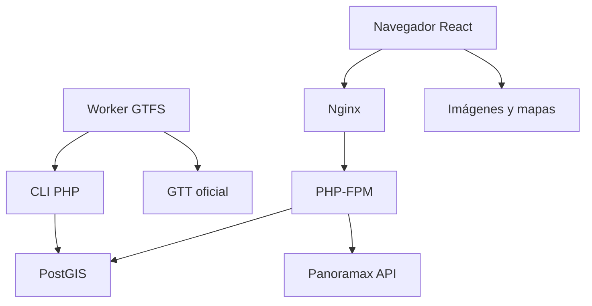
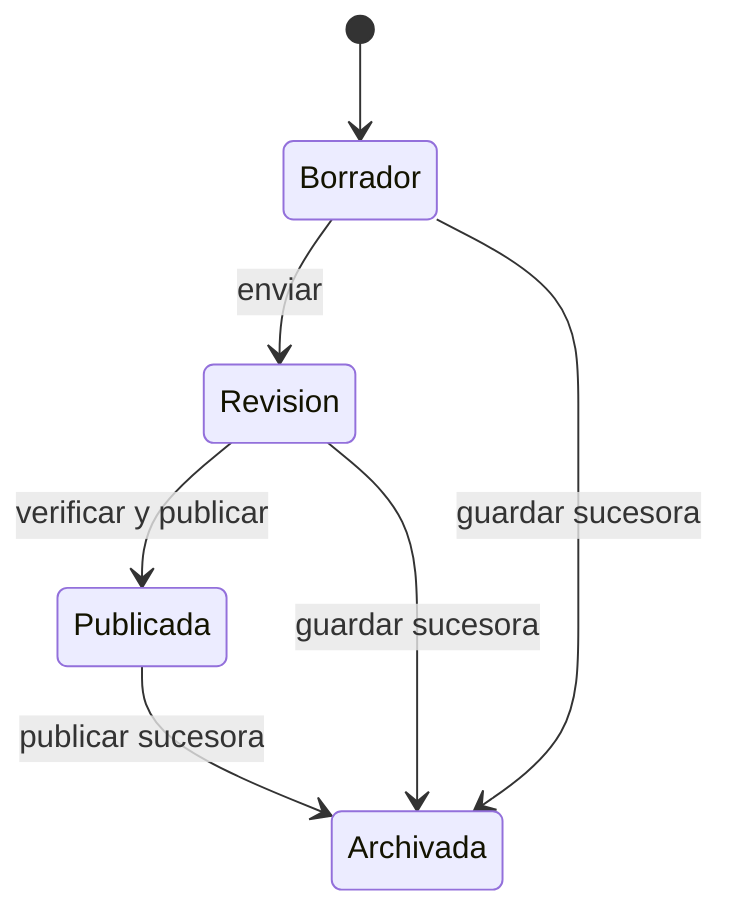

# Arquitectura y decisiones

## Contrato del dominio

El sistema guarda recorridos fijos, no planes calculados por tráfico/tiempo. El
LineString WGS84 conserva vértices en orden de marcha. El orden de paradas e
instrucciones es parte del documento. Guardar, importar, usar GPS o mirar fotos no
permite reemplazarlo con el camino más corto.

Una **línea** es su código comercial. Una **variante** representa sentido/tipo/shape
y patrón operativo; tiene un número de versión para concurrencia y un puntero a la
publicación vigente. Una **revisión** es el documento completo con su propio UUID y
número consecutivo. GPS y estudio virtual seleccionan un `revisionId` concreto.

Las paradas tienen una identidad canónica compartida por código externo. Cada
`route_stops` conserva su snapshot, secuencia, cambio, sentido de cambio y notas.
Los cambios de nombre/posición del registro canónico no reescriben publicaciones.
Una circular puede visitar varias veces la misma identidad.

## Servicios y fronteras

| Componente | Responsabilidad | Persistencia |
| --- | --- | --- |
| React/TypeScript | Catálogo, editor, mapa, GPS local, reproductor virtual | Preferencias/IndexedDB de publicaciones |
| MapLibre | Dibujar overlays almacenados y un marcador activo | Sin caché masiva de tiles |
| Nginx | Assets, fallback SPA, FastCGI y entrega interna de medios | Lectura del volumen de medios |
| PHP 8.3-FPM | Sesión, validación, revisiones, informes, medios y metadatos Panoramax | PDO/PostGIS y archivos privados |
| PostGIS 16 | Snapshots, índices espaciales, concurrencia, auditoría y cachés | Volumen `pgdata` |
| Worker Python | Reserva de descarga, hash/validación/conversión y llamada CLI | `serverdata/gtfs` |

Nginx sirve la web y las rutas amigables. PHP corre con FPM; no hay Apache ni cron
requeridos. `gtfs-sync` es un proceso Docker independiente con reinicio automático.
Consulta localmente cada hora y solo hace HTTP cuando vence su reserva mínima de 24 h.

## Ciclo editorial e inmutabilidad

Guardar crea una revisión nueva y archiva la antigua copia de trabajo. Revertir
hace lo mismo desde un snapshot histórico. `expectedVersion` comprueba y bloquea
la variante antes de mutar. El puntero publicado se cambia atómicamente; los
triggers protegen documentos, geometría, hijos y asociaciones de medios publicados.
La auditoría de negocio es append-only y forma parte de la misma transacción.

`RouteRepository::transaction()` participa en una transacción existente sin
confirmarla por su cuenta. Esto permite lotes e ingestión GTFS completos: cualquier
fallo de validación, identidad o auditoría revierte la operación entera.

## Fuentes automáticas

La clave GTFS contiene route_id, shape_id, direction_id y patrón ordenado de stop_id.
El SHA del ZIP decide si hay que convertir; el hash del documento excluye fecha de
descarga y sustituciones del UUID canónico. Un cambio solo de horarios no produce
otra revisión de geometría. La conversión conserva el archivo anterior hasta acabar.

La ingestión crea borradores de sistema y adopta importaciones iniciales idénticas.
Respeta publicaciones, ediciones manuales, revisiones en revisión y papelera.
Conflictos, patrones ausentes y rechazados quedan trazados en `gtfs_route_links` y
el manifiesto; nunca se borran rutas porque una fuente dejó de listarlas.
[Protocolo completo](GTFS_SYNC.md).

## Navegación y estudio

`geometry.ts` mide/proyecta sobre segmentos existentes. `matchFix` restringe avance
por tiempo y ancla, comprueba precisión/edad/rumbo y conserva el progreso ante fallos.
No usa un servicio de routing. El watcher GPS solo vive en el navegador y se libera
al detener. El reproductor virtual usa la misma medición y es excluyente con GPS.

Panoramax recibe celdas derivadas de la revisión guardada. Sus imágenes son contexto:
no definen giros ni progreso. Los metadatos factuales se filtran y cachean; los
panoramas 360° usan un visor cargado de forma diferida. [Contrato](VIRTUAL_TOURS.md).

## API, permisos y seguridad

La base es `/api/v1`. Revisiones, papelera, reportes e imágenes usan segmentos de
ruta; los query parameters de la API propia se rechazan. Proveedores externos
conservan los parámetros que requiere su API. [OpenAPI](openapi.yaml) define el contrato.

Se usan contraseñas Argon2id, cookies HttpOnly/SameSite Strict/Secure fuera de
desarrollo, sesión con vencimiento, cuentas habilitadas verificadas en cada petición,
CSRF y Origin para escrituras. El servidor decide visibilidad/rol en cada endpoint.
Las consultas son preparadas; los límites atómicos residen en Postgres y sobreviven
múltiples procesos FPM. No se confía ciegamente en cabeceras de IP del cliente.

Uploads viven fuera del document root, con UUIDs y asociaciones inmutables. Nginx
solo sirve archivos tras la autorización FastCGI mediante `X-Accel-Redirect`.
Los reportes se generan con HTML escapado, SVG propio y thumbnails locales; Dompdf
no carga recursos remotos. [Límites de medios](MEDIA_AND_URLS.md).

Los fallos públicos llevan code, number y trace_id. Los inesperados usan un mensaje
opaco y diagnósticos saneados independientes en DB, NDJSON con lock acotado y log
nativo PHP. La auditoría de negocio permanece separada. [Procedencia](SHORTENER_REUSE.md).

## Offline, migraciones y límites

El service worker conserva shell, assets y referencias estáticas. IndexedDB guarda
solo publicaciones actuales no eliminadas. No cachea sesiones, respuestas API,
borradores, videos privados ni tiles externos. Un borrador no se hace público por
abrir su deep link o adjuntar una foto.

Las migraciones SQL se ejecutan en orden con checksum y bloqueo consultivo. Nunca
editar una aplicada; crear la siguiente. Las capas no dependen del despliegue de
Shortener. Se adaptaron patrones documentados y el pequeño helper de lock, con
procedencia explícita en su DocBlock.

Quedan separados de las funciones implementadas los datos operativos pendientes:
calles y maniobras revisadas, movimientos DAPER individualizados, direcciones de
puestos Gerbido y PDF de turnos/servicios. [Estado verificable](ROADMAP.md).
